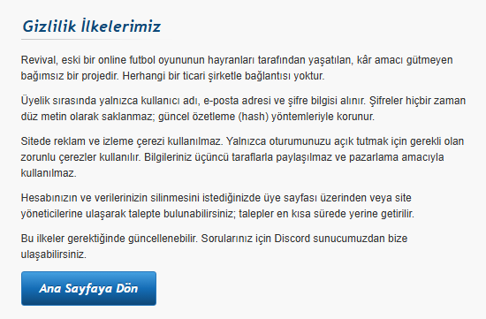

# Revival

**Tek cümle:** Hile önleme katmanı, hilecileri kalıcı olarak yasaklayabilmek için donanım kimliklerini (anakart ve disk seri numaraları) topluyordu, ama gizlilik metni bunu yazmıyordu.

---

## Sorun neydi

Revival'ın istemcisi, hile önleme amacıyla bilgisayardan donanım kimliklerini okuyordu: anakart ve disk seri numaraları, sistem UUID'si, Windows `MachineGuid` değeri ve ağ adaptörünün MAC adresi.

Sorun **verinin toplanması değildi**. Hile önleme için cihaz bağlama yaygın ve savunulabilir bir uygulama. **Vanguard** da aynı şekilde çalışıyor, üstelik çok daha derin bir erişimle.

Sorun şuydu: **gizlilik metni bunu yazmıyordu.** O tarihteki metin ([webarchive kaydı](https://web.archive.org/web/20261027150957/https://playrevival.co/privacy)) aynen şöyleydi:



Yani kullanıcı, nelerin toplandığını okuyarak öğrenemiyordu. Mesele buydu.

---

## Nasıl bulundu

Launcher binary'sini incelerken, sistem bilgisi toplayan fonksiyonun içinde şu sorgular düz metin olarak görüldü:

```text
SELECT Index,SerialNumber FROM Win32_DiskDrive
SELECT SerialNumber FROM Win32_BaseBoard
SELECT UUID FROM Win32_ComputerSystemProduct
SOFTWARE\Microsoft\Cryptography
```

Bunlar Windows'un kendi yönetim arayüzünün (WMI) sorguları. Yani uygulama işletim sisteminden doğrudan anakartın ve diskin seri numarasını istiyor. Import tablosunda ayrıca `GetAdaptersAddresses` (MAC) ve SetupAPI cihaz numaralandırma çağrıları var.

Bunlar tahmin değil: binary'nin içinde, offset'leriyle birlikte duruyor. Doğrulama adımları [`detay.md`](detay.md) içinde.

---

## Şimdi ne durumda

- Gizlilik metni güncellendi. Önceden toplanan verilerin silindiği belirtildi.

---

## Ne bulunmadı

Konuşulanların dışında benim incelediğim süreçte aşağıdakiler **bulunmadı**:

- Mining: yok
- Backdoor: yok
- Dosya okuma veya dışarı sızdırma: yok
- Şifre toplama: yok
- Kötü niyet: kodda buna dair bir bulgu yok

---

## Kapsam

Sadece istemci tarafı incelendi; sunucu kodu görülmedi.

Yöntem: statik analiz (IDA), çalışma zamanı gözlemi (salt okunur hook'lar), PEB okuma ve dosya sistemi testleri.

---

## Kaynaklar

- `https://playrevival.co/privacy`: gizlilik metni
- `https://api.playrevival.co/api/v1/patch/live`: imzalı oyun manifesti
- `https://patch.playrevival.co/objects/<sha256>`: içerik adresli dosyalar

Teknik detaylar ve tekrar üretme adımları: [`detay.md`](detay.md)

---


